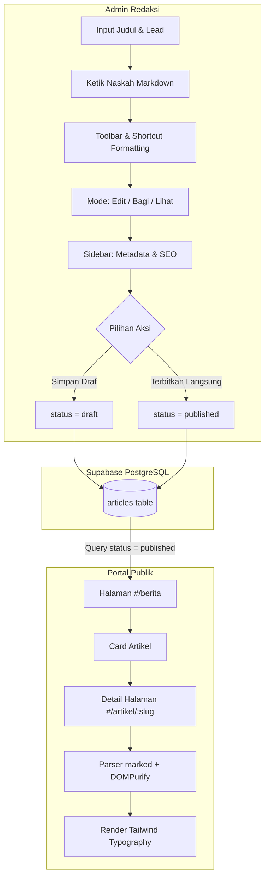

<!-- [AGENT-GENERATED]
Description : Dokumentasi arsitektur dan flow pembuatan artikel SuaR Indonesia (Markdown-First & Live Preview)
Created     : 2026-10-17
Modified    : 2026-10-17
Part of     : docs/architecture/article-flow.md
-->

# 📝 Alur Pembuatan & Rendering Artikel (Markdown-First)

## 📌 Ringkasan
Fitur artikel SuaR Indonesia mengadopsi konsep **Meja Redaksi Kemplo Style** yang memadukan kecepatan penulisan format **Markdown murni**, live preview interaktif, dan manajemen metadata terstruktur (Kategori, Foto Sampul, Tag Topik Terkait, Distribusi, serta SEO Google).

---

## 🏗️ Diagram Alur Data End-to-End

---

## ⚙️ Spesifikasi Komponen

### 1. Panel Editor (Kiri)
- **Judul Berita**: Input besar dengan counter realtime `0/70 karakter` dan auto-slug generator.
- **Lead / Paragraf Pembuka**: Counter `0/160 karakter` yang memikat pembaca dan menjadi ringkasan kartu.
- **Lembar Naskah**: Textarea Markdown dengan toolbar (Bold, Italic, Underline, H1-H3, List, Quote, Link, Image, Video Embed, Dateline).
- **Mode Switcher**:
  - `✏️ Edit`: Fokus menulis.
  - `[] Bagi`: Split view (editor kiri + live preview kanan).
  - `👁 Lihat`: Full rendered HTML preview.

### 2. Panel Sidebar (Kanan)
- **Metadata**: Kategori (`berita`, `program`, `kegiatan`, `artikel`), Foto Sampul Utama (Cover), Tag Chip UI (`#warta`, `#nusantara`), Penulis, Tanggal Terbit, dan Video Utama.
- **Distribusi**: Pemilihan kanal sindikasi dan media sosial.
- **SEO Google**: SERP Snippet Preview realtime, Meta Title, dan Meta Description.

### 3. Rendering Pipeline 3-Lapis (Public Site)
Renderer `ArticleDetailTemplate` mengecek konten dengan urutan berikut:
1. `content_markdown` (Markdown string) ➔ Di-parse via `marked.js` dan disanitasi via `DOMPurify`.
2. `content` (JSONB array) ➔ Di-render sebagai blok terstruktur (kompatibilitas mundur artikel lama).
3. `content` (Plain HTML string) ➔ Fallback artikel legacy.

---

## 🔗 Navigasi
- Kembali ke [Indeks Arsitektur](./index.md)
